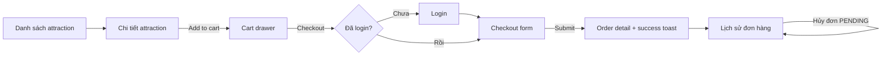

# ParkPass: Bài tập React Fundamentals (2 tuần)

> **Người giao:** anh Hùng · **Người làm:** `<tên em>` · **Timebox:** 10 ngày làm việc (full-time)
> **Kickoff:** `__/__` · **Mid-review:** cuối ngày 5 · **Final demo:** cuối ngày 10
> Dựa trên [roadmap.sh/react](https://roadmap.sh/react). File này nên được commit vào repo tại `docs/ASSIGNMENT.md`.

---

## 0. Đọc cái này trước

### Mục tiêu

| # | Mục tiêu | Em sẽ được đánh giá qua |
|---|----------|-------------------------|
| 1 | **Hệ thống hóa kiến thức React** theo roadmap: không chỉ "chạy được" mà **giải thích được tại sao** | Code + `docs/LEARNING.md` + Q&A khi demo |
| 2 | **Làm quen môi trường developer thật**: ticket, branch, PR, code review, CI, deploy | Lịch sử Git, PR, pipeline, standup |
| 3 | Tạo ra sản phẩm đủ để anh **đánh giá và lên learning plan** tiếp theo cho em | Toàn bộ repo |

**Không phải mục tiêu:** UI đẹp như Dribbble, dùng càng nhiều lib càng tốt, làm xong 100% phần BONUS.

### Luật chơi

| Luật | Chi tiết |
|------|----------|
| **Timebox** | 10 ngày. Hết giờ thì dừng và ghi rõ còn thiếu gì. 80% chắc chắn tốt hơn 100% chắp vá. |
| **Ưu tiên** | `MUST` > `SHOULD` > `BONUS`. Không đụng BONUS khi MUST chưa xong. |
| **Core trước, lib sau** | Milestone 1 **cấm** cài TanStack Query, Zustand, React Hook Form, Zod. Lý do ở mục 2. |
| **Rule 30 phút** | Bí quá 30 phút thì hỏi, nhưng hỏi theo template ở mục 9. Tự vật lộn 30 phút là học, 3 tiếng là lãng phí. |
| **AI tools** | Được dùng (Copilot, Claude, ChatGPT...) như một người pair. Nhưng: (1) mọi dòng code em merge, em phải giải thích được; (2) ghi rõ trong PR mục "AI usage"; (3) `LEARNING.md` phải tự viết bằng lời của em. Demo cuối có phần **live-change code không dùng AI**. |
| **Daily standup** | Gửi trước 9h30 trên Teams/Slack, **bằng tiếng Anh**, format ở mục 9. |
| **Không push thẳng `main`** | Mọi thay đổi đi qua PR, anh review và approve. |

---

## 1. Bối cảnh sản phẩm

**ParkPass** là web app đặt vé các trò chơi, điểm tham quan trong một hệ thống khu vui chơi (dữ liệu giả lập). User có thể tìm và lọc attraction, xem chi tiết, thêm vé vào giỏ, đăng nhập, checkout, xem và hủy đơn hàng.



---

## 2. Tech stack

| Hạng mục | Lựa chọn | Ghi chú |
|----------|----------|---------|
| Build tool | **Vite** (template `react-ts`) | Create React App đã bị deprecated từ 02/2025 (xem LEARNING Q1) |
| Language | **TypeScript** `strict` | Cấm `any` bằng ESLint rule |
| UI library | **React 19** | Chưa bật React Compiler cho đến khi xong `PERF.md` (M2) |
| Routing | **React Router v7** (data mode: `createBrowserRouter`) | Dùng từ M1 |
| Server state | M1: `fetch` + `useEffect` tự viết → M3: **TanStack Query v5** | |
| Client state | M1: `useReducer` + Context → M3: **Zustand v5** | Auth, Theme giữ ở Context |
| Forms | M1: controlled form tự validate → M3: **React Hook Form + Zod** | |
| Styling | **Tailwind CSS v4** + đúng 1 component viết bằng **CSS Modules** | Để so sánh trong ADR |
| Mock API | **MSW v2** (dùng chung cho dev, test, demo production) | Contract ở mục 4 |
| Unit / Integration test | **Vitest + React Testing Library + user-event** | |
| E2E test | **Playwright** | |
| Code quality | ESLint (flat config) + Prettier + Husky + lint-staged + commitlint | |
| Package manager | **pnpm**, pin Node LTS bằng `.nvmrc` | |
| CI | **Azure Pipelines** (hoặc GitHub Actions nếu repo trên GitHub) | |
| Deploy | **Vercel** (preview + production) | |

> **Tại sao "core trước, lib sau"?**
> Ở M1 em tự viết những thứ mà lib sẽ giải quyết: loading/error state, race condition, cache, validate form, share state. Khi refactor ở M3, em sẽ **thấy tận mắt** lib giải quyết vấn đề gì và đánh đổi cái gì, thay vì dùng lib như hộp đen. Đây là mục đích chính của bài, đừng "đi tắt" bằng cách cài lib sớm.

---

## 3. Yêu cầu chức năng (User stories)

Mỗi story có ID `PP-xx`, dùng làm tên ticket, branch, commit scope và PR title.

### PP-01 · Danh sách attraction `MUST`

> *As a visitor, I want to browse and filter attractions so that I can quickly find something to book.*

- [ ] Grid card: ảnh, tên, park, category, giá thấp nhất ("Từ 150.000 ₫"), rating.
- [ ] Search theo tên, **debounce 400ms** (custom hook `useDebounce`).
- [ ] Filter theo park (select) và category (checkbox, chọn nhiều); sort theo giá tăng/giảm, rating.
- [ ] Pagination 12 item/trang (hoặc "Load more").
- [ ] **Filter đồng bộ với URL** (`useSearchParams`): copy URL gửi người khác, mở ra đúng kết quả; nút Back/Forward của browser hoạt động đúng. URL là *source of truth*, không duplicate vào `useState`.
- [ ] Đủ **4 trạng thái UI**: loading (skeleton), error (có nút Retry), empty ("Không tìm thấy..." + nút Clear filters), success.
- [ ] Nhấn phím `/` để focus ô search (`useRef` + keyboard event). Bỏ qua khi user đang gõ trong một input khác.
- [ ] Gõ nhanh "ab" rồi xóa, kết quả hiển thị cuối cùng phải khớp với ô search (không bị race condition khi mock API trả về lệch thứ tự).

### PP-02 · Chi tiết attraction `MUST`

- [ ] Route `/attractions/:id`. `id` không tồn tại → trang 404 riêng, không phải màn trắng.
- [ ] Mô tả, gallery ảnh. Click ảnh mở **lightbox** (Portal), `Esc` để đóng, đóng xong **trả focus về ảnh vừa click**.
- [ ] Chọn loại vé (Adult / Child / Senior) + số lượng qua component `QuantityStepper` (**controlled**, min 0, max 10).
- [ ] Nút "Add to cart" disabled khi tổng số lượng bằng 0. Thêm xong hiện toast.

### PP-03 · Giỏ hàng `MUST`

- [ ] Cart drawer mở từ header, đóng bằng `Esc` hoặc click overlay. Icon cart có badge số lượng.
- [ ] Sửa số lượng, xóa item, hiển thị tổng tiền (VND qua `Intl.NumberFormat('vi-VN', { style: 'currency', currency: 'VND' })`).
- [ ] Giỏ hàng còn nguyên sau khi reload trang (localStorage).
- [ ] M1: `useReducer` + `CartContext` · M3: Zustand + middleware `persist`.

### PP-04 · Đăng nhập giả lập + protected routes `MUST`

- [ ] Trang `/login` (email + password). Tài khoản test: `demo@parkpass.dev` / `Passw0rd!`.
- [ ] `AuthContext` cung cấp `user`, `login()`, `logout()`. Token lưu localStorage (và giải thích trong LEARNING Q33 tại sao production không nên làm vậy).
- [ ] `/checkout` và `/orders/*` yêu cầu đăng nhập. Chưa login → redirect `/login?redirect=/checkout`, login xong quay lại đúng trang. Chỉ chấp nhận `redirect` là path nội bộ.
- [ ] Làm route guard theo **2 cách**: HOC `withAuth(Component)` và layout route `<RequireAuth />` (dùng `<Outlet />`). Giữ 1 cách trong app, cách còn lại đặt ở `docs/patterns/`, so sánh ở LEARNING Q18.

### PP-05 · Checkout `MUST`

- [ ] Fields: họ tên, email, số điện thoại Việt Nam, ngày tham quan (không ở quá khứ, tối đa 90 ngày tới), mã khuyến mãi (optional, **validate async** qua `GET /api/promo-codes/:code`), checkbox đồng ý điều khoản.
- [ ] Lỗi hiển thị dưới từng field. Submit có lỗi → **focus vào field lỗi đầu tiên**.
- [ ] Nút submit disabled + spinner khi đang gửi, chặn double submit.
- [ ] Server trả `422` kèm `fieldErrors` → hiển thị lỗi đúng field.
- [ ] Thành công → `POST /api/orders` → clear cart → điều hướng tới `/orders/:id` kèm toast success.
- [ ] M1: controlled inputs + validate tay · M3: React Hook Form + Zod, type form lấy từ `z.infer`.

### PP-06 · Lịch sử đơn hàng `MUST`

- [ ] `/orders`: danh sách đơn của user, badge trạng thái `PENDING` / `PAID` / `CANCELLED`. `/orders/:id`: chi tiết.
- [ ] Hủy đơn (chỉ khi `PENDING`) qua confirm modal (Portal).
- [ ] M3: **optimistic update** khi hủy; lỗi thì rollback + toast.

### PP-07 · Theme sáng / tối `SHOULD`

- [ ] `ThemeContext`, lưu lựa chọn của user, mặc định theo `prefers-color-scheme`.

### PP-08 · Xử lý lỗi, lazy loading `MUST`

- [ ] `ErrorBoundary` **tự viết bằng class component** (không dùng lib ở bài này), có nút "Thử lại" để reset.
- [ ] Đặt ở 2 tầng: **global** (toàn app) và **widget** (lỗi ở widget reviews không làm sập cả trang chi tiết).
- [ ] Route-level `errorElement` của React Router.
- [ ] Lazy load route `/checkout`, `/orders` bằng `React.lazy` + `Suspense` với skeleton fallback. Chứng minh bằng Network tab là chunk đã được tách.

### PP-09 · Reviews widget `SHOULD`

- [ ] Trên trang chi tiết, hiển thị reviews (`GET /api/attractions/:id/reviews`). Mock có 20% xác suất trả `500`.
- [ ] Render bằng component generic `<List<T> items renderItem renderEmpty />` (**render props**).
- [ ] M1: widget tự hiển thị lỗi inline + Retry · M3: chuyển sang `useSuspenseQuery` + `Suspense` + `ErrorBoundary`.

---

## 4. API contract (mock bằng MSW)

Base URL: `/api` (config qua `VITE_API_BASE_URL`). Mọi response lỗi có dạng `ApiError`.

| Method | Path | Auth | Mô tả | Response |
|--------|------|:----:|-------|----------|
| GET | `/api/attractions?q=&park=&category=&sort=&page=1&limit=12` | | Danh sách, `sort`: `price_asc` \| `price_desc` \| `rating_desc`; `category` lặp được nhiều lần | `200 { data: Attraction[], total, page, limit }` |
| GET | `/api/attractions/:id` | | Chi tiết | `200 Attraction` · `404` |
| GET | `/api/attractions/:id/reviews` | | Reviews (20% lỗi) | `200 Review[]` · `500` |
| GET | `/api/parks` | | Danh sách park | `200 Park[]` |
| POST | `/api/auth/login` | | Body `{ email, password }` | `200 { token, user }` · `401` |
| GET | `/api/me` | ✔ | User hiện tại | `200 User` · `401` |
| GET | `/api/promo-codes/:code` | | Kiểm tra mã | `200 { code, discountPercent }` · `404` |
| POST | `/api/orders` | ✔ | Tạo đơn, **server tự tính giá** | `201 Order` · `422` |
| GET | `/api/orders` | ✔ | Đơn của user | `200 Order[]` |
| GET | `/api/orders/:id` | ✔ | Chi tiết đơn | `200 Order` · `404` |
| PATCH | `/api/orders/:id/cancel` | ✔ | Hủy đơn | `200 Order` · `409` nếu không phải `PENDING` |

```ts
export type TicketType = 'ADULT' | 'CHILD' | 'SENIOR';
export type Category = 'THRILL' | 'FAMILY' | 'KIDS' | 'SHOW' | 'WATER';

export interface Park { id: string; name: string; city: string }

export interface Attraction {
  id: string;
  name: string;
  parkId: string;
  category: Category;
  description: string;
  images: string[];
  rating: number;                        // 0 - 5
  prices: Record<TicketType, number>;    // VND
}

export interface Review {
  id: string; attractionId: string; author: string;
  rating: number; comment: string; createdAt: string; // ISO 8601
}

export interface User { id: string; name: string; email: string }

export interface OrderItem {
  attractionId: string; attractionName: string;
  ticketType: TicketType; quantity: number; unitPrice: number;
}

export interface Order {
  id: string; userId: string; items: OrderItem[];
  visitDate: string; promoCode?: string;
  subtotal: number; discount: number; total: number;
  status: 'PENDING' | 'PAID' | 'CANCELLED';
  createdAt: string;
}

export interface ApiError {
  code: string;                           // ví dụ 'VALIDATION_ERROR', 'UNAUTHORIZED'
  message: string;
  fieldErrors?: Record<string, string>;   // chỉ có ở 422
}
```

**Quy tắc cho mock:**

- Seed tối thiểu **30 attractions**, **4 parks**, **3 promo codes**, ảnh dùng placeholder.
- **Latency ngẫu nhiên 300 - 1200ms** (`delay()` của MSW) để thấy loading state và tái hiện race condition.
- `POST /api/orders` **tự tính lại giá từ seed data**, bỏ qua giá client gửi lên (đừng bao giờ tin client).
- Orders lưu vào localStorage bên trong mock, reload vẫn còn.
- **Chaos mode:** `localStorage.setItem('pp:chaos', '1')` → mọi request có 30% xác suất trả `500`. Dùng để demo error state.
- **Large dataset:** `localStorage.setItem('pp:large', '1')` → mock sinh 500 attractions và cho phép `limit` tối đa 500 (dùng cho Performance lab ở M2).

---

## 5. Milestones và kế hoạch 10 ngày

| Milestone | Ngày | Trọng tâm | PR dự kiến | Checkpoint với anh |
|-----------|------|-----------|:----------:|--------------------|
| **M0** Setup | D1 - D2 | Repo, tooling, CI, mock API | 2 - 3 | Review PR setup |
| **M1** Core React | D3 - D5 | React thuần, không lib state/data/form | 4 - 5 | **Mid-review 30'** cuối D5 |
| **M2** Advanced React | D6 - D7 | Auth, Portals, Error Boundary, Suspense, Performance | 3 - 4 | Review PR |
| **M3** Ecosystem refactor | D8 - D9 | TanStack Query, Zustand, RHF + Zod | 3 - 4 | Review PR |
| **M4** Ship | D10 | E2E, deploy, docs, demo | 1 - 2 | **Final demo 60'** |

> Test viết **cùng lúc** với feature ở mọi milestone, không để dồn đến M4. PR không có test sẽ bị request changes.

### M0 · Setup môi trường (D1 - D2)

- [ ] Tạo board (Azure Boards hoặc Jira) với story PP-01 → PP-09 và các task kỹ thuật. Mỗi PR link tới work item.
- [ ] `pnpm create vite parkpass --template react-ts`, thêm `.nvmrc` (Node LTS).
- [ ] `tsconfig`: `strict: true`, `noUncheckedIndexedAccess: true`, path alias `@/*` → `src/*`.
- [ ] ESLint flat config: `typescript-eslint`, `eslint-plugin-react-hooks` (`rules-of-hooks` và `exhaustive-deps` ở mức **error**), `eslint-plugin-jsx-a11y`, `@typescript-eslint/no-explicit-any: error`. Prettier cho format.
- [ ] Husky + lint-staged (pre-commit: `eslint --fix` + `prettier --write` trên file staged), commitlint (hook `commit-msg`) theo Conventional Commits.
- [ ] Scripts trong `package.json`: `dev`, `build`, `preview`, `lint`, `typecheck`, `test`, `test:coverage`, `test:e2e`, `format`.
- [ ] `.env.example` gồm `VITE_API_BASE_URL`, `VITE_ENABLE_MOCKS`. File `.env*.local` nằm trong `.gitignore`.
- [ ] Tạo folder structure theo mục 6.
- [ ] MSW: `pnpm dlx msw init public/ --save`, viết handlers theo contract mục 4, seed data, `src/mocks/browser.ts` (dev/demo) và `src/mocks/node.ts` (test). Chỉ start worker khi `VITE_ENABLE_MOCKS === 'true'`.
- [ ] Vitest + RTL: môi trường `jsdom`, file setup start/reset/close MSW server.
- [ ] CI pipeline: install (có cache) → lint → typecheck → test → build. Branch policy: PR vào `main` phải CI xanh + 1 approve.
- [ ] PR template (mục 6) đặt ở `.github/pull_request_template.md` hoặc `.azuredevops/pull_request_template.md`.
- [ ] `README.md`: giới thiệu, yêu cầu môi trường, cách chạy, bảng scripts, cấu trúc thư mục, tài khoản test, link deploy.

**DoD M0:** người khác clone repo trên máy sạch → `pnpm i && pnpm dev` chạy được trong **dưới 5 phút** chỉ bằng README · CI xanh · commit sai convention bị hook chặn.

### M1 · Core React, không lib (D3 - D5)

- [ ] Hoàn thành **PP-01, PP-02, PP-03, PP-05 (controlled form), PP-07** bằng React thuần.
- [ ] Tự viết custom hooks:
  - `useFetch<T>(url)` trả `{ status, data, error, refetch }`; `status` là union type (`'loading' | 'success' | 'error'`), không dùng 3 biến boolean rời rạc; hủy request cũ bằng `AbortController` trong cleanup.
  - `useDebounce<T>(value, delay)`, `useLocalStorage<T>(key, initial)`, `useKeyboardShortcut(key, handler)`.
- [ ] Cart: `cartReducer` là **pure function**, action là discriminated union, không mutate state, có unit test cho từng action.
- [ ] Bộ UI primitives theo **composition** trong `components/ui`: `Button` (variants), `Card` dạng compound (`Card.Image`, `Card.Body`, `Card.Footer`), `Badge`, `Skeleton`, `Drawer`, `Modal`, `Layout` với slot props (`header`, `aside`). Không dùng kế thừa class để tái sử dụng UI.
- [ ] Styling: Tailwind v4 cho toàn app; riêng `TicketSummaryCard` viết bằng **CSS Modules**.
- [ ] Tests: `cartReducer`, các custom hooks (`renderHook`), 1 integration test cho PP-01 (gõ search → danh sách cập nhật, API mock bằng MSW), 1 test cho `QuantityStepper`.
- [ ] Thí nghiệm `docs/experiments/key-bug.md`: cho mỗi `CartItem` một state nội bộ (ví dụ ô ghi chú uncontrolled), cố tình dùng **index làm key**, xóa item đầu tiên → quan sát bug, chụp màn hình, giải thích nguyên nhân, rồi fix.

**DoD M1:** đủ 4 trạng thái UI ở mọi màn có gọi API · console không có error/warning · không có `eslint-disable` cho `exhaustive-deps` · tests pass.

**Mid-review (30', cuối D5):** em demo nhanh M1, anh hỏi về `useFetch`, reducer, key bug. Điều chỉnh scope M2 - M4 nếu cần.

### M2 · Advanced React (D6 - D7)

- [ ] **PP-04** Auth + 2 cách guard (HOC và layout route).
- [ ] **PP-06** Orders, fetch bằng `useFetch`, hủy đơn chưa cần optimistic.
- [ ] **PP-08** `ErrorBoundary` class (`getDerivedStateFromError` + `componentDidCatch`), global + widget, `errorElement`, lazy routes + `Suspense`.
- [ ] **Portals:** refactor `Modal`, `Drawer`, `Toast`, lightbox sang `createPortal`. Kèm: focus trap, `Esc` để đóng, trả focus khi đóng, khóa scroll `body`, `role="dialog"` + `aria-modal` + `aria-labelledby` (id tạo bằng `useId`). Ghi lại trong PR: trước khi dùng Portal có bug `z-index` / `overflow: hidden` nào không.
- [ ] **Class component + lifecycle:** viết `ParkClosingCountdown` (đếm ngược tới giờ đóng cửa của park) bằng class component với `componentDidMount` / `componentDidUpdate` / `componentWillUnmount`, rồi viết lại bằng hooks. Lập bảng mapping lifecycle ↔ hooks trong LEARNING Q6.
- [ ] **Performance lab** → `docs/PERF.md`:
  1. Bật large dataset (500 item), dùng **React DevTools Profiler** record lúc gõ search.
  2. Tìm component re-render thừa, ghi số liệu (commit duration, số component render).
  3. Áp dụng tối thiểu: `React.memo`, `useMemo`, `useCallback`, và `useDeferredValue` **hoặc** `useTransition`.
  4. Record lại, so sánh trước/sau bằng screenshot + số liệu.
  5. Ghi rõ **chỗ nào memo không đáng** và vì sao.
- [ ] Tests: auth redirect, `ErrorBoundary` render fallback + reset, `Modal` đóng bằng `Esc` và trả focus.

**DoD M2:** toàn bộ flow dùng được chỉ bằng bàn phím · `dist/assets` có chunk riêng cho checkout, orders · `PERF.md` có số liệu thật.

### M3 · Ecosystem refactor (D8 - D9)

Mỗi refactor là **1 PR riêng**, PR description có mục **Before / After**.

- [ ] **TanStack Query** thay `useFetch`:
  - Query key factory (ví dụ `attractionKeys.list(filters)`), `staleTime` hợp lý, `placeholderData: keepPreviousData` cho pagination.
  - Prefetch chi tiết attraction khi hover card.
  - `useMutation` cho checkout và hủy đơn; hủy đơn dùng **optimistic update** (`onMutate` snapshot → `onError` rollback → `onSettled` invalidate).
  - Reviews widget chuyển sang `useSuspenseQuery` + `Suspense` + `ErrorBoundary` + `QueryErrorResetBoundary`.
- [ ] **Zustand** thay `CartContext`: store với `persist`, component đọc bằng selector (`useCartStore((s) => s.totalQuantity)`). Auth và Theme **giữ ở Context**, giải thích lý do trong ADR-0001.
- [ ] **React Hook Form + Zod** cho checkout: `checkoutSchema` là single source of truth, type lấy từ `z.infer`, async validate promo code, `setFocus` field lỗi, map `fieldErrors` từ `422` vào `setError`.
- [ ] Xóa code cũ không còn dùng (nhưng giữ `useFetch` trong `docs/patterns/` để so sánh).
- [ ] `docs/MIGRATION.md`: bảng before/after gồm số dòng code, edge case trước phải tự xử lý giờ lib lo, trade-off, bundle size thay đổi bao nhiêu (so output `vite build`).
- [ ] 3 ADR trong `docs/adr/`: `0001-state-management.md`, `0002-styling.md`, `0003-data-fetching.md` (template ở mục 6).

### M4 · Ship (D10)

- [ ] **Playwright E2E**: 1 happy path (search → detail → add to cart → login → checkout → thấy order) + 1 negative case (checkout lỗi validate). Chạy trong CI (chromium).
- [ ] **Coverage** ≥ 70% cho `src/features/**`, cấu hình threshold trong Vitest để CI fail nếu thấp hơn.
- [ ] **Accessibility**: đi hết flow chính chỉ bằng bàn phím; Lighthouse Accessibility ≥ 90; không còn lỗi `jsx-a11y`.
- [ ] **Deploy Vercel** với `VITE_ENABLE_MOCKS=true` (MSW chạy trên bản demo), có rewrite SPA về `index.html`. Link để trong README.
- [ ] Hoàn thiện `docs/LEARNING.md`, tag release `v1.0.0`.
- [ ] `docs/RETRO.md` **bằng tiếng Anh**: *What went well / What didn't go well / What I'll do differently*.

### BONUS (chỉ khi toàn bộ MUST đã xong)

- [ ] Port trang chi tiết attraction sang **Next.js App Router** (Server Component fetch data + `generateMetadata`), so sánh CSR và SSR trong LEARNING Q30.
- [ ] Bật **React Compiler**, đo lại theo quy trình Performance lab, ghi vào `PERF.md`.
- [ ] Storybook cho `components/ui`.
- [ ] Animation cho drawer, modal (Motion hoặc CSS transition).
- [ ] Tách `api`, `schemas`, `stores` thành module không phụ thuộc DOM, dựng 1 màn hình **React Native (Expo)** dùng lại chúng.

---

## 6. Engineering standards

### Folder structure (feature-based)

```text
src/
  app/              # App.tsx, router.tsx, providers.tsx
  components/ui/    # Button, Card, Modal, Drawer, Toast, Skeleton... (không chứa business logic)
  features/
    attractions/    # components/, hooks/, api.ts, types.ts, __tests__/
    cart/
    auth/
    checkout/
    orders/
    reviews/
  hooks/            # hook dùng chung: useDebounce, useLocalStorage, useKeyboardShortcut
  lib/              # http client, formatters, logger
  mocks/            # handlers.ts, data/, browser.ts, node.ts
  styles/
  main.tsx
docs/
  adr/  experiments/  patterns/
  ASSIGNMENT.md  LEARNING.md  PERF.md  MIGRATION.md  RETRO.md
e2e/
```

### Code conventions

| Quy tắc | Ví dụ / Ghi chú |
|---------|-----------------|
| Component `PascalCase`, hook `useXxx` | `AttractionCard.tsx`, `useDebounce.ts`, test cạnh file: `AttractionCard.test.tsx` |
| Component quá ~150 dòng thì tách | Tách theo trách nhiệm, không tách cho có |
| Không `any`, không `@ts-ignore` | Bắt buộc thì dùng `@ts-expect-error` kèm comment lý do |
| Không `eslint-disable` cho `exhaustive-deps` | Muốn disable nghĩa là effect đang thiết kế sai: đọc *You Might Not Need an Effect* |
| Derived state tính trong render | `total` tính từ `items`, không lưu vào state rồi sync bằng `useEffect` |
| Không `console.log` trong code được merge | Dùng `lib/logger.ts` |
| Test query theo thứ tự ưu tiên của Testing Library | `getByRole` > `getByLabelText` > `getByText` > ... > `getByTestId` |

### Git workflow

| Hạng mục | Quy ước |
|----------|---------|
| Branch | `feat/PP-01-attraction-list`, `fix/PP-03-cart-total`, `refactor/PP-03-zustand-cart`, `chore/setup-ci`, `docs/perf-lab` |
| Commit | Conventional Commits, tiếng Anh: `feat(cart): add quantity stepper`, `fix(checkout): prevent double submit`, `test(cart): cover remove item action` |
| PR size | ≤ ~400 dòng thay đổi (không tính lockfile, file generated). 1 PR = 1 mục đích |
| Trước khi xin review | Rebase lên `main`, CI xanh, **tự review diff của mình trước** |
| Merge | Squash merge sau khi được approve |
| Xử lý comment review | Sửa rồi reply `Done in <commit>`, hoặc giải thích vì sao không sửa. **Không tự resolve comment của reviewer** |

### PR template

```md
## What
<!-- Tóm tắt thay đổi. Link work item: PP-xx -->

## Why
<!-- Vấn đề cần giải quyết / lý do chọn cách này -->

## How to test
1. ...
2. ...

## Screenshots / Recording
<!-- Bắt buộc với thay đổi UI -->

## Checklist
- [ ] Self-reviewed my own diff
- [ ] Tests added/updated, `pnpm test` passes
- [ ] `pnpm lint && pnpm typecheck` pass
- [ ] Loading / error / empty states handled
- [ ] Keyboard accessible
- [ ] No console errors or warnings

## AI usage
<!-- None / Dùng AI cho phần nào, em đã tự kiểm tra và sửa lại những gì -->

## Notes for reviewer
<!-- Chỗ nào em chưa chắc, muốn anh xem kỹ -->
```

### ADR template (`docs/adr/000X-<title>.md`)

```md
# ADR-000X: <Quyết định>
- Status: Accepted
- Date: YYYY-MM-DD

## Context
<!-- Bối cảnh, ràng buộc, vấn đề cần quyết -->

## Options considered
| Option | Pros | Cons |
|--------|------|------|

## Decision
<!-- Chọn gì và tại sao -->

## Consequences
<!-- Được gì, mất gì, khi nào nên xem lại quyết định này -->
```

### Definition of Done (mọi PR)

- [ ] Đáp ứng đủ acceptance criteria của story
- [ ] Có test cho logic mới, CI xanh
- [ ] Đủ loading / error / empty states
- [ ] Dùng được bằng bàn phím, không lỗi `jsx-a11y`
- [ ] Không còn code chết, `console.log`, TODO không có ticket
- [ ] README / docs được cập nhật nếu thay đổi cách chạy hoặc cấu trúc

---

## 7. Deliverables

| # | Deliverable | Vị trí | Milestone |
|---|-------------|--------|:---------:|
| 1 | Source code + lịch sử PR | Repo | M0 → M4 |
| 2 | README chạy được từ máy sạch | `README.md` | M0 |
| 3 | CI pipeline + branch policy | `azure-pipelines.yml` hoặc `.github/workflows/ci.yml` | M0 |
| 4 | Thí nghiệm key bug | `docs/experiments/key-bug.md` | M1 |
| 5 | So sánh 2 cách route guard, `useFetch` cũ | `docs/patterns/` | M2, M3 |
| 6 | Performance lab | `docs/PERF.md` | M2 |
| 7 | 3 ADR | `docs/adr/` | M3 |
| 8 | Báo cáo refactor | `docs/MIGRATION.md` | M3 |
| 9 | Trả lời câu hỏi kiến thức | `docs/LEARNING.md` | Viết dần, xong ở M4 |
| 10 | Retrospective (English) | `docs/RETRO.md` | M4 |
| 11 | Link deploy Vercel | README | M4 |
| 12 | Daily standup (English) | Teams / Slack | Hằng ngày |

---

## 8. Final demo (60 phút)

| Thời lượng | Nội dung |
|:----------:|----------|
| 10' | Em demo flow chính theo kịch bản tự chuẩn bị. Bật **chaos mode** để demo error states |
| 15' | Code walkthrough: 3 đoạn code em tự hào nhất + 1 đoạn em chưa hài lòng và sẽ sửa thế nào |
| 15' | **Live change**: anh đưa 1 - 2 yêu cầu nhỏ, em sửa trực tiếp, không dùng AI. Anh quan tâm cách em đọc code, debug và nói ra suy nghĩ, không bắt buộc phải xong |
| 15' | Q&A dựa trên `LEARNING.md` |
| 5' | Retro nhanh + feedback 2 chiều |

---

## 9. Giao tiếp hằng ngày

### Daily standup (English, gửi trước 9h30)

```text
Yesterday: Finished PP-01 search & filters, opened PR #7.
Today: Address review comments on #7, then start PP-02 detail page.
Blockers: None. / Need clarification on promo code rules for expired codes.
```

### Khi bí quá 30 phút: hỏi theo template

```text
Context:  Đang làm PP-05 checkout, branch feat/PP-05-checkout-form
Expected: Submit lỗi thì focus vào field lỗi đầu tiên
Actual:   Focus không nhảy, console không có lỗi (screenshot đính kèm)
Tried:    1) Gọi ref.current.focus() trong handleSubmit  2) Đọc docs useRef
Question: Em nên đặt ref ở đâu khi field được render bằng map()?
```

> Một câu hỏi tốt gồm: bối cảnh, kỳ vọng, thực tế, **đã thử gì**, câu hỏi cụ thể. Viết ra được như vậy thì 50% trường hợp em sẽ tự tìm ra đáp án.

---

## 10. Roadmap coverage: bài tập này phủ roadmap thế nào

| Roadmap node | Áp dụng ở đâu trong bài | Kiểm chứng qua |
|--------------|-------------------------|----------------|
| CLI Tools: Vite, Create React App | M0 setup bằng Vite | LEARNING Q1 |
| Components: Functional | Toàn bộ app | Code |
| Components: Class | `ErrorBoundary`, `ParkClosingCountdown` | Code + LEARNING Q6 |
| JSX | Toàn bộ app | LEARNING Q2 |
| Props vs State | `QuantityStepper` (controlled), cart, lift state up | LEARNING Q3, Q4 |
| Conditional Rendering | 4 trạng thái UI, badge, UI theo trạng thái login | PR review |
| Composition vs Inheritance | `Card` compound, `Layout` slots | Code + LEARNING Q5 |
| Rendering | Performance lab | `PERF.md` + LEARNING Q7, Q11 |
| Component Life Cycle | `ParkClosingCountdown` class vs hooks | LEARNING Q6 |
| Lists and Keys | Grid attraction, cart, key bug experiment | `key-bug.md` + LEARNING Q8 |
| Render Props | `<List renderItem>`, `ErrorBoundary fallback` | Code + LEARNING Q19 |
| Refs | Phím `/`, focus field lỗi, trả focus lightbox | Code + LEARNING Q16 |
| Events | Keyboard shortcut, form, click trong card | Code |
| High Order Components | `withAuth` | `docs/patterns/` + LEARNING Q18 |
| Hooks: useState, useEffect | Toàn bộ M1 | LEARNING Q12 - Q14 |
| Hooks: Writing Custom Hooks | `useFetch`, `useDebounce`, `useLocalStorage`, `useKeyboardShortcut` | Code + LEARNING Q17 |
| Hooks: Common Hooks | `useReducer`, `useContext`, `useRef`, `useMemo`, `useCallback`, `useId`, `useDeferredValue` / `useTransition` | Code + LEARNING Q15 |
| Routing: React Router, Reach Router | React Router v7 data mode, protected routes, URL state | LEARNING Q23 |
| State Management: Context | Auth, Theme, Cart (M1) | ADR-0001 |
| State Management: Zustand | Cart (M3) | ADR-0001 + MIGRATION |
| State Management: Redux, MobX, Recoil | Không code, so sánh lý thuyết | LEARNING Q25 |
| Styling: Tailwind CSS, CSS Modules | Toàn app + `TicketSummaryCard` | ADR-0002 |
| Styling: Styled components, Emotion, Material UI, Chakra UI, Mantine | So sánh lý thuyết | ADR-0002 + LEARNING Q27 |
| API Calls: React Query | M3 | MIGRATION + ADR-0003 |
| API Calls: Axios, SWR, RTK Query, Apollo, Relay, urql, Superagent | So sánh lý thuyết | LEARNING Q26 |
| Testing: Vitest, React Testing Library, Playwright | M0 → M4 | Code + CI + LEARNING Q29 |
| Testing: Jest, Cypress | So sánh lý thuyết | LEARNING Q29 |
| SSR Frameworks: Next.js, Remix | BONUS port + lý thuyết | LEARNING Q30 |
| Forms: React Hook Form | M1 (tay) → M3 (RHF + Zod) | MIGRATION + LEARNING Q28 |
| Forms: Formik, Final Form | So sánh lý thuyết | LEARNING Q28 |
| Suspense | Lazy routes, `useSuspenseQuery` | LEARNING Q22 |
| Portals | Modal, Drawer, Toast, lightbox | LEARNING Q20 |
| Error Boundaries | Global + widget | LEARNING Q21 |
| Fiber Architecture | Performance lab | LEARNING Q9 |
| Mobile: React Native | Lý thuyết + BONUS | LEARNING Q31 |
| *Ngoài roadmap:* TypeScript, Zod, Git, CI/CD, a11y, security cơ bản | Toàn bài | LEARNING Q32, Q33 |

---

## 11. `docs/LEARNING.md`: câu hỏi em cần trả lời

**Cách trả lời:**

- Viết **bằng lời của em** (tiếng Việt, giữ thuật ngữ English), mỗi câu 3 - 10 dòng. Không copy docs hay output AI.
- Mỗi câu **kèm link tới file/dòng code** trong repo nơi em đã áp dụng (nếu có).
- "Em chưa chắc" là câu trả lời hợp lệ, miễn là ghi em đã thử tìm hiểu gì và đang hiểu tới đâu.
- Viết dần theo milestone, đừng để dồn đến ngày cuối.

### A. Nền tảng

1. Vite khác Create React App thế nào? Vì sao CRA bị deprecated? `pnpm dev` và `pnpm build` khác nhau ra sao (dev server phục vụ native ESM vs bundle cho production)?
2. JSX được compile thành gì? Vì sao tên component phải viết hoa chữ cái đầu? Vì sao một component chỉ trả về 1 root (và `Fragment` giải quyết việc đó thế nào)?
3. Props khác State thế nào? Chỉ ra 1 chỗ trong code em đã **lift state up** và lý do.
4. Controlled vs uncontrolled input: em dùng loại nào, ở đâu, vì sao?
5. Vì sao React khuyên dùng composition thay vì inheritance? Minh họa bằng `Card`, `Layout` của em.
6. Khi nào vẫn phải dùng class component? Lập bảng mapping lifecycle methods ↔ hooks từ bài `ParkClosingCountdown`.

### B. Rendering

7. Một component re-render khi nào? Phân biệt **render phase** và **commit phase**.
8. Reconciliation hoạt động thế nào và `key` đóng vai trò gì? Giải thích bug trong `key-bug.md`. Khi nào dùng index làm key là chấp nhận được?
9. Fiber là gì, giải quyết vấn đề gì so với stack reconciler cũ? Liên hệ với `useTransition` / `useDeferredValue` em dùng trong Performance lab.
10. `React.memo`, `useMemo`, `useCallback` có ích khi nào, vô ích hoặc có hại khi nào? Dẫn số liệu từ `PERF.md`. React Compiler thay đổi điều gì ở đây?
11. Vì sao `StrictMode` chạy effect 2 lần ở môi trường dev? Nó đã giúp em phát hiện bug nào chưa?

### C. Hooks

12. Rules of Hooks là gì và vì sao chúng tồn tại (gợi ý: React lưu state của hook theo thứ tự gọi)?
13. Dependency array của `useEffect` hoạt động thế nào? Cleanup chạy khi nào? Race condition trong `useFetch` xảy ra ra sao và em xử lý thế nào?
14. Theo bài *You Might Not Need an Effect*: liệt kê ít nhất 2 chỗ em đã bỏ `useEffect` (derived state, xử lý trong event handler...).
15. `useState` vs `useReducer`: vì sao cart dùng reducer? Kể tên các common hooks em đã dùng và mỗi cái để làm gì.
16. `useRef` khác `useState` thế nào? Liệt kê mọi chỗ em dùng ref. Ở React 19, truyền `ref` cho function component thay đổi gì so với `forwardRef`?
17. Hai component cùng dùng `useDebounce` có share state với nhau không? Vì sao?

### D. Patterns

18. So sánh HOC `withAuth`, layout route `<RequireAuth />` và custom hook `useRequireAuth()`. Vì sao HOC ngày nay ít được dùng hơn?
19. Render props vs custom hook: `<List renderItem>` có thay bằng hook được không? Khi nào render props vẫn là lựa chọn hợp lý?
20. Vì sao Modal cần Portal? Event phát ra từ bên trong Portal bubble lên theo **React tree** hay **DOM tree**?
21. Error Boundary bắt được lỗi nào và **không** bắt được lỗi nào (event handler, async code, SSR, lỗi trong chính boundary)? Những lỗi không bắt được, em xử lý thế nào?
22. `Suspense` thực chất "chờ" cái gì? `React.lazy` hoạt động ra sao? Chứng minh bằng Network tab.

### E. Ecosystem

23. Client-side routing khác server routing thế nào? Vì sao deploy SPA cần rewrite mọi path về `index.html`? Reach Router bây giờ ra sao?
24. Server state khác client state thế nào? Vì sao không nên bỏ danh sách attraction vào Zustand? TanStack Query làm được những gì mà `useFetch` của em chưa làm (cache, dedupe, stale-while-revalidate, retry, refetch on window focus...)?
25. Context vs Zustand vs Redux Toolkit vs MobX vs Recoil: mỗi cái hợp với bối cảnh nào? (Gợi ý: kiểm tra tình trạng maintain hiện tại của Recoil trước khi trả lời.) Vì sao dùng Context cho mọi thứ dễ gây re-render thừa?
26. `fetch` vs Axios (và Superagent); SWR vs TanStack Query vs RTK Query; REST vs GraphQL (Apollo, Relay, urql): khi nào chọn cái nào?
27. Tailwind vs CSS Modules vs CSS-in-JS runtime (styled-components, Emotion) vs component library (Material UI, Chakra UI, Mantine). Vì sao CSS-in-JS runtime gặp khó với React Server Components?
28. React Hook Form (uncontrolled) vs Formik / Final Form (controlled): khác nhau thế nào về số lần re-render? Vì sao đã validate ở client mà server vẫn phải validate?
29. Testing pyramid: unit vs integration vs E2E trong repo của em là những test nào? Vì sao Testing Library khuyên `getByRole` thay vì `getByTestId`? Jest vs Vitest, Cypress vs Playwright khác nhau ra sao?
30. CSR (app của em) vs SSR / SSG / React Server Components (Next.js, Remix / React Router framework mode): trade-off về SEO, tốc độ hiển thị lần đầu, độ phức tạp. Nếu làm thật, trang nào của ParkPass nên SSR?
31. Nếu làm app mobile bằng React Native, phần nào trong code của em dùng lại được, phần nào không? Vì sao?

### F. Dev workflow và security cơ bản

32. Mô tả flow từ lúc nhận ticket đến lúc code lên production trong project này. CI của em chặn được loại lỗi nào, **chưa** chặn được loại lỗi nào?
33. Vì sao production không nên lưu token trong localStorage? Có phương án nào tốt hơn? Nếu ai đó gửi link `/login?redirect=https://evil.com` thì app của em xử lý thế nào?

---

## 12. Tài liệu tham khảo

| Chủ đề | Link |
|--------|------|
| Roadmap | [roadmap.sh/react](https://roadmap.sh/react) |
| **Đọc hết phần Learn** (bắt buộc trong tuần 1) | [react.dev/learn](https://react.dev/learn) |
| Thinking in React | [react.dev/learn/thinking-in-react](https://react.dev/learn/thinking-in-react) |
| You Might Not Need an Effect | [react.dev/learn/you-might-not-need-an-effect](https://react.dev/learn/you-might-not-need-an-effect) |
| Preserving and Resetting State (key) | [react.dev/learn/preserving-and-resetting-state](https://react.dev/learn/preserving-and-resetting-state) |
| Error Boundary | [react.dev/reference/react/Component](https://react.dev/reference/react/Component#catching-rendering-errors-with-an-error-boundary) |
| React Router | [reactrouter.com](https://reactrouter.com) |
| TanStack Query: Important Defaults | [tanstack.com/query](https://tanstack.com/query/latest/docs/framework/react/guides/important-defaults) |
| Zustand | [zustand.docs.pmnd.rs](https://zustand.docs.pmnd.rs) |
| React Hook Form · Zod | [react-hook-form.com](https://react-hook-form.com) · [zod.dev](https://zod.dev) |
| MSW | [mswjs.io](https://mswjs.io) |
| Testing Library: query priority | [testing-library.com](https://testing-library.com/docs/queries/about/#priority) |
| Common mistakes with RTL | [kentcdodds.com](https://kentcdodds.com/blog/common-mistakes-with-react-testing-library) |
| Playwright | [playwright.dev](https://playwright.dev) |
| Conventional Commits | [conventionalcommits.org](https://www.conventionalcommits.org) |

> Chúc em làm tốt. Mục tiêu không phải là không mắc lỗi, mà là **mỗi lỗi em mắc đều được ghi lại và hiểu vì sao**. Có gì cứ hỏi anh.
