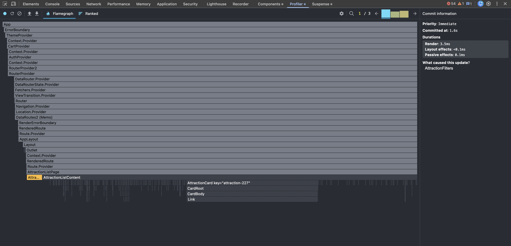
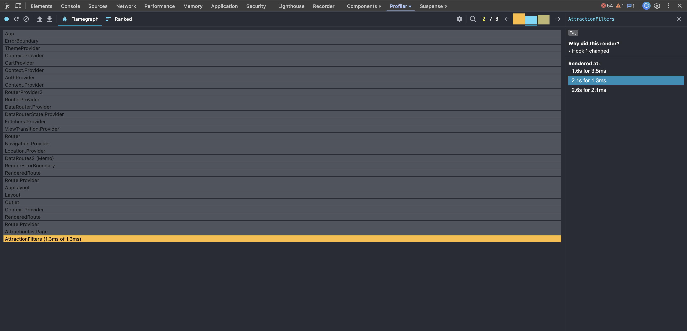
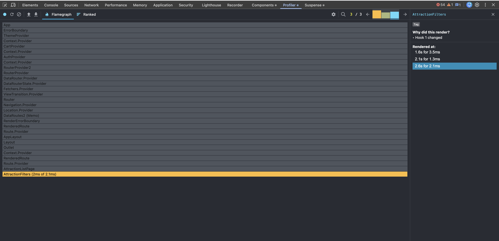
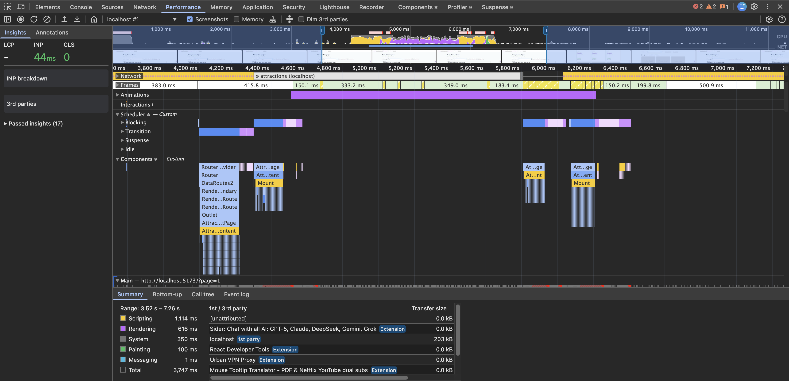
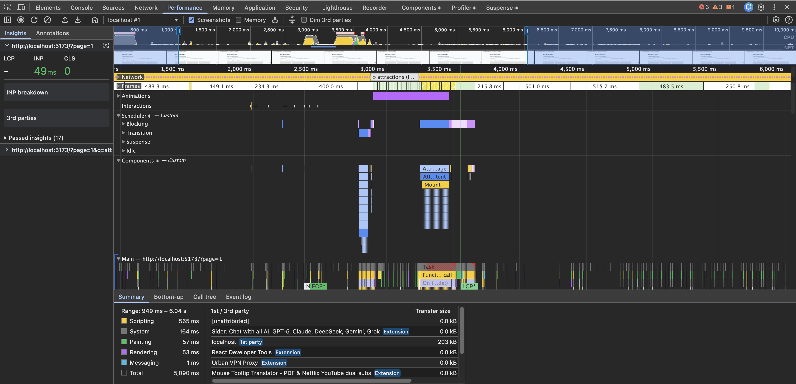

# Performance lab

## 1. Mục tiêu

Performance lab kiểm tra trải nghiệm tìm kiếm trên trang danh sách khi MSW trả
về large dataset gồm 500 attractions. Mục tiêu không phải loại bỏ mọi lần
render, mà là tránh để toàn bộ trang và 500 cards render lại theo từng ký tự
người dùng nhập.

Yêu cầu hoàn chỉnh của lab gồm:

- đo trước và sau khi tối ưu;
- ghi commit duration và những component đã render;
- thử `React.memo`, `useMemo`, `useCallback` và `useDeferredValue` hoặc
  `useTransition`;
- giải thích trường hợp memo không mang lại lợi ích.

Tài liệu gồm phép đo thao tác nhập search, baseline của toàn bộ search flow và
phép đo sau tối ưu. Hai full-flow traces dùng cùng kịch bản và cùng Chrome
Performance panel để có thể so sánh.

## 2. Môi trường đo

| Hạng mục              | Giá trị                                 |
| --------------------- | --------------------------------------- |
| Ngày đo               | 2026-09-29                              |
| React                 | 19.2.8                                  |
| React Developer Tools | 8.0.0                                   |
| Trình duyệt           | Chrome                                  |
| Dataset               | 500 attractions                         |
| Bật large mode        | `localStorage.setItem("pp:large", "1")` |
| Thao tác local state  | Gõ nhanh `abc` vào ô search             |
| Thao tác full flow    | Gõ nhanh `att` vào ô search             |

React Developer Tools 8.0.0 kết thúc phiên ghi của Profiler khi
`setSearchParams()` tạo Router navigation. Vì vậy, riêng phép đo thao tác gõ
được thực hiện với debounce tạm thời là 5000ms để có đủ thời gian dừng Profiler
trước khi URL được commit. Giá trị dùng trong ứng dụng vẫn phải được trả về
400ms sau khi đo.

Phép đo toàn bộ luồng `typing -> URL -> fetch -> render result` dùng Chrome
Performance panel với React Components tracks, vì công cụ này giữ được dữ liệu
qua client-side navigation.

## 3. Vấn đề của cách xử lý search ban đầu

Ban đầu, giá trị input được đọc trực tiếp từ `searchParams`. Mỗi `onChange` gọi
`setSearchParams()`, vì vậy gõ `abc` có thể tạo ba Router navigation:

```text
gõ "a"   -> URL q=a   -> navigation -> render page -> fetch
gõ "ab"  -> URL q=ab  -> navigation -> render page -> fetch
gõ "abc" -> URL q=abc -> navigation -> render page -> fetch
```

Đây không phải document reload, nhưng Router và route tree vẫn phải xử lý một
navigation sau mỗi ký tự.

## 4. Thay đổi đã áp dụng

Search được tách thành hai giá trị có trách nhiệm khác nhau:

| Giá trị       | Vai trò                                                      |
| ------------- | ------------------------------------------------------------ |
| `searchDraft` | State cục bộ trong `AttractionFilters`, cập nhật ngay khi gõ |
| `searchText`  | Query đã commit trên URL, dùng để tạo request API            |

Luồng mới:

```text
gõ "abc"
  -> chỉ cập nhật searchDraft
  -> debounce sau lần gõ cuối
  -> commit q=abc lên URL một lần
  -> AttractionListPage fetch kết quả mới
```

`lastSyncedSearchRef` phân biệt cập nhật do người dùng gõ với cập nhật đi từ
URL xuống khi Back, Forward hoặc Clear filters. `handleSearchCommit` được bọc
bằng `useCallback` để giữ function identity ổn định khi được dùng trong
dependency array của effect.

URL vẫn là source of truth của filter đã áp dụng. `searchDraft` chỉ là bản nháp
trong thời gian người dùng đang nhập.

Các tối ưu được áp dụng trước phép đo thứ hai:

- `AttractionListContent`, `AttractionFilters` và `AttractionCard` được bọc
  bằng `React.memo`;
- các handler truyền xuống component con dùng `useCallback`;
- danh sách category và map từ park id sang park name dùng `useMemo`;
- `Intl.NumberFormat` được đưa ra module scope để không tạo lại trong từng
  card;
- loading state chỉ hiển thị 12 skeleton đại diện thay vì tạo 500 skeleton;
- URL search commit được thử trong `useTransition`, đồng thời
  `isSearchPending` được truyền xuống input qua `aria-busy`.

## 5. Kết quả React DevTools Profiler

Phiên đo ghi nhận đúng ba commits, tương ứng với ba lần cập nhật local state khi
gõ `a`, `b`, `c`.

|         Commit | Render duration | Component gây update | Component ứng dụng đã render |
| -------------: | --------------: | -------------------- | ---------------------------- |
|              1 |           3.5ms | `AttractionFilters`  | `AttractionFilters`          |
|              2 |           1.3ms | `AttractionFilters`  | `AttractionFilters`          |
|              3 |           2.1ms | `AttractionFilters`  | `AttractionFilters`          |
| **Trung bình** |       **2.3ms** |                      | **1 component/commit**       |

Tổng render duration của ba commits là 6.9ms; commit nhanh nhất là 1.3ms và
commit chậm nhất là 3.5ms.

Profiler báo `Hook 1 changed` trong cả ba lần render. Đây là state đầu tiên của
`AttractionFilters`, tương ứng với `searchDraft` trong implementation hiện tại.

Trong Flamegraph, `AttractionFilters` có màu vì đã render. Các component như
`AttractionListPage`, `AttractionListContent` và `AttractionCard` có màu xám
hoặc gạch chéo, nghĩa là chúng thuộc cây React nhưng không render trong commit
đang xem.

Kết quả chính:

```text
mỗi ký tự
  -> AttractionFilters render
  -> AttractionListPage không render
  -> AttractionListContent không render
  -> 500 AttractionCard không render
```

### Commit 1 - 3.5ms



### Commit 2 - 1.3ms



### Commit 3 - 2.1ms



## 6. Baseline toàn bộ search flow trước memoization

### Kịch bản đo

Baseline này được ghi sau khi `searchDraft` đã được chuyển xuống
`AttractionFilters`, nhưng trước khi thêm `React.memo`, `useMemo`, giới hạn số
skeleton hoặc thử transition.

```text
1. Bật large dataset gồm 500 attractions
2. Chờ danh sách ban đầu tải xong
3. Bắt đầu Chrome Performance recording
4. Gõ nhanh "att"
5. Chờ debounce, URL navigation, request và kết quả mới render xong
6. Dừng recording
```

Từ khóa `att` khớp với tên `Attraction ...` của large dataset, nên kết quả sau
search vẫn giữ trường hợp nặng gồm 500 items.

### Số liệu đọc từ React Components tracks

`AttractionListContent` render bốn lần trong full flow:

| Giai đoạn                         | Duration | Dấu hiệu trong trace                                | Đánh giá                            |
| --------------------------------- | -------: | --------------------------------------------------- | ----------------------------------- |
| URL vừa commit, dữ liệu chưa đổi  |  222.4ms | Props deeply equal; callback props có reference mới | Render thừa                         |
| Chuyển `success` sang `loading`   |  163.8ms | Mount loading subtree mất 154.7ms                   | Đang tạo 500 skeleton               |
| Nhận array mới khi UI còn loading |  118.4ms | `attractions` khác reference nhưng deeply equal     | Cần kiểm tra render trung gian      |
| Chuyển `loading` sang `success`   |  131.3ms | Mount result subtree mất 130.5ms                    | Phần lớn là render 500 cards hợp lệ |

Tổng duration của bốn lần render `AttractionListContent` là khoảng 635.9ms.
Hai điểm nổi bật nhất là:

- lần render 222.4ms xảy ra dù dữ liệu hiển thị chưa thay đổi;
- loading mount 500 skeleton và tiêu tốn 154.7ms, trong khi UI chỉ cần một số
  lượng placeholder đại diện.

`AttractionFilters` render bốn lần với tổng khoảng 2.8ms. Trace chỉ ra các props
không ổn định:

- `selectedCategories` khác reference nhưng deeply equal;
- `onParkChange`, `onSortChange`, `onCategoryChange` là function closure mới;
- callback props của `AttractionListContent` như `getParkName`, `onRetry`,
  `onClearFilters`, `onPageChange` cũng có reference mới.

Chi phí của filters nhỏ, nhưng đây là dữ liệu thực tế để thử `useMemo`,
`useCallback` và `React.memo`. Chi phí lớn hơn nằm ở list content, skeleton và
cards.

Chrome ghi nhận `INP 44ms` và `CLS 0` trong phiên này. Các số tổng hợp như
Scripting hoặc Rendering không được dùng làm số liệu chính vì trace còn chứa
hoạt động của browser extensions.



Raw trace được giữ ngoài repository với tên
`Trace-20260929T143223.json.gz`. File nén có dung lượng khoảng 8.2MB và giải nén
khoảng 150MB, nên không được commit vào Git.

## 7. Kết quả toàn bộ search flow sau tối ưu

After trace dùng lại large dataset 500 items và từ khóa `att`. Trace ghi nhận
ba lần render của `AttractionListContent`, thay vì bốn lần ở baseline.

| Giai đoạn                        |    Baseline |             Sau tối ưu |   Thay đổi |
| -------------------------------- | ----------: | ---------------------: | ---------: |
| URL commit, trước loading        |     222.4ms |                 66.4ms |     -70.1% |
| Chuyển sang loading              |     163.8ms |                  3.8ms |     -97.7% |
| Render trung gian khi loading    |     118.4ms | Không còn commit riêng | Đã loại bỏ |
| Chuyển sang 500 kết quả mới      |     131.3ms |                215.1ms |     +63.8% |
| **Tổng `AttractionListContent`** | **635.9ms** |            **285.3ms** | **-55.1%** |

Loading subtree riêng giảm từ 154.7ms xuống 3.4ms, tương đương giảm 97.8%.
Đây là tác động rõ nhất và đến từ việc chỉ render 12 skeleton thay vì 500.

Ở baseline, React Components track ghi nhận 489 `CardRoot`, 388 `CardBody` và
293 `CardFooter` events trong lượt render thừa trước loading. Sau khi dùng
`React.memo(AttractionCard)`, after trace không còn các named card events ở
giai đoạn đó. `AttractionListContent` vẫn phải chạy `.map()` và so sánh các
props của card, nhưng function component và subtree bên trong từng card không
render lại.

Lần mount 500 kết quả cuối tăng từ 130.5ms lên 203.0ms và toàn bộ list ở giai
đoạn này tăng từ 131.3ms lên 215.1ms. Đây là mount hợp lệ với 500 object mới từ
API, nên `React.memo` không thể bỏ qua. Số đo này cũng chịu ảnh hưởng của độ
dao động trong development và browser extensions. Vì vậy kết luận đúng là
tổng flow đã giảm, không phải mọi commit đều nhanh hơn.

`AttractionFilters` có hai component renders trong after trace, tổng 2.0ms.
Một render đổi `isSearchPending` sang `true`, render còn lại nhận `searchText`
mới và đưa pending về `false`. Chi phí nhỏ, nhưng cho thấy `useTransition` có
thêm bookkeeping; nó không làm request nhanh hơn.

Chrome ghi nhận `INP 49ms` và `CLS 0`. Baseline là `INP 44ms`, nên phép đo này
không chứng minh INP tốt hơn. Chênh lệch 5ms nhỏ hơn mức dao động có thể kỳ
vọng ở development trace có extension. Bằng chứng đáng tin hơn trong lab này
là React component durations và số render ở cùng một flow.

Raw after trace được giữ ngoài repository với tên
`Trace-20260929T152934.json.gz` và không được commit vào Git.



## 8. Memoization có đáng dùng ở đâu?

### Có ích

- `React.memo(AttractionCard)` có ích khi parent render với cùng attraction
  objects: after trace đã loại bỏ các card subtree renders trước loading.
- `useMemo` tạo `parkNamesById` giúp tránh quét toàn bộ parks cho từng card và
  giữ map ổn định khi parks không đổi.
- `useCallback` giúp component memoized nhận callback ổn định trong các render
  không thay đổi dependency.
- Giảm số skeleton là tối ưu có hiệu quả lớn hơn memoization trong phép đo này.

### Ít hoặc không có ích

- `React.memo(AttractionFilters)` không thể chặn render do chính
  `searchDraft` thay đổi; controlled input vẫn phải render một lần cho mỗi ký
  tự để hiển thị ngay nội dung người dùng gõ.
- `React.memo(AttractionCard)` không giúp lần mount kết quả mới vì API trả về
  các attraction objects mới và loading state đã unmount danh sách cũ.
- `useMemo` cho `selectedCategories` không giữ được cùng reference khi toàn bộ
  `searchParams` đổi. Chi phí tạo mảng category rất nhỏ nên thêm deep-compare
  hoặc custom cache chỉ để loại bỏ việc này không đáng với độ phức tạp.
- Một số callback phụ thuộc `searchParams` phải đổi khi URL đổi. Ép chúng ổn
  định bằng ref hoặc custom comparator dễ tạo stale state và chưa có bằng
  chứng rằng chi phí hiện tại đáng để đánh đổi.
- `useTransition` thể hiện pending state đúng semantics, nhưng input đã được
  cô lập bằng local state nên lợi ích performance trong trace này nhỏ. Nếu sản
  phẩm không dùng pending UI, có thể bỏ transition sau lab để code đơn giản
  hơn.

## 9. Giới hạn của phép đo

- Đây là phép đo sau khi tách `searchDraft`; chưa có số liệu Profiler có thể so
  sánh trực tiếp từ implementation cũ.
- Debounce được tạm tăng lên 5000ms chỉ để tránh giới hạn của Profiler 8.0.0.
- React DevTools Profiler measurement chỉ đo thao tác gõ; full-flow baseline
  được đo riêng bằng Chrome Performance để giữ dữ liệu qua URL navigation.
- DevTools hiển thị một số console errors trong lúc chụp; đây là một nguồn
  nhiễu khác cần ghi nhận khi đọc kết quả.
- Cả hai full-flow traces chứa hoạt động của Sider, Urban VPN, translator và
  các browser extensions khác. Vì vậy chỉ dùng React Components durations làm
  số liệu chính và không so sánh tổng Scripting/Rendering của toàn recording.
- Số đo trong development có thêm profiling overhead; chỉ dùng để so sánh các
  lần đo trong cùng môi trường, không xem là thời gian production tuyệt đối.

## 10. Trạng thái Performance lab

- [x] Đưa debounce từ 5000ms về đúng yêu cầu 400ms.
- [x] Ghi baseline toàn bộ search flow trong Chrome Performance panel.
- [x] Ghi after trace bằng cùng kịch bản và cùng công cụ.
- [x] Ghi render duration của các giai đoạn trong baseline full flow.
- [x] So sánh số component render giữa baseline và after trace.
- [x] Áp dụng và đo `React.memo` tại một vị trí có bằng chứng render thừa.
- [x] Áp dụng và đo `useMemo` cho một phép tính có chi phí hoặc cần stable
      reference.
- [x] Dùng `useCallback` để giữ ổn định `handleSearchCommit`.
- [x] Thử `useDeferredValue` hoặc `useTransition` và so sánh before/after.
- [x] Chụp screenshot before/after từ cùng một loại trace.
- [x] Kiểm tra và giải thích rõ vị trí memo không đáng dùng.
